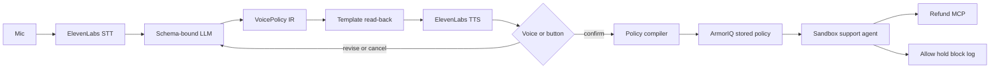

# Voice Policy Builder

Admins govern AI agents by talking. They speak a rule, hear it read back in plain English, say "confirm," and it becomes a live ArmorIQ policy.

Finance managers, support leads, and compliance officers know the rules. They do not write JSON. Today those rules stay in a doc, or an engineer approximates them in config. This product turns one spoken sentence into the policy ArmorIQ actually enforces, and then proves it with a sandbox agent.

The acceptance sentence:

> Refunds up to $100 are fine. Anything over $100 needs manager approval. Never refund to an account that isn't in the CRM.

The read-back that must be spoken before anything is applied:

> I'll allow refunds up to $100, hold refunds over $100 for manager approval, and block refunds to accounts that aren't in the CRM. Say confirm to apply.

The proof is three live calls through ArmorIQ, using whatever policy confirm just pushed. The refund limits are not hardcoded in the agent.

## Verdict

Build this. Do not switch to the Voice Prompt-Injection Gauntlet.

Checked against `https://api.armoriq.ai` and the policy client shipped at `https://platform.armoriq.ai` on 17 Oct 2026. Creating and activating a policy is a real API. The SDK API key is the wrong credential for it. A dashboard access token is the right one, and `POST /auth/login` issues that token.

What is proven:

- `POST /policies` exists. With no header it returns `401` and `Access token is required`.
- `x-api-key` is ignored on that route. The same body with `x-api-key: ak_not_real` still says an access token is required.
- `Authorization: Bearer <token>` is the header the dashboard sends. A fake bearer returns `401` and `Invalid access token`, which means the route parsed the header and rejected the signature.
- `POST /auth/login` exists. An empty body returns `400` with `email must be an email` and `password must be a string`. The dashboard stores `data.accessToken` and `data.refreshToken` from that response and sends `Authorization: Bearer <accessToken>` plus `x-organization-id`.
- `POST /policies/:policyId/activate`, `PUT /policies/:policyId`, and `POST /policies/yaml/import` are the same auth. A fake bearer on activate and on YAML import returns `Invalid access token`.
- The create body is JSON, not the YAML file. The dashboard's `createPolicy` posts `name`, `targetType`, `targetId`, `defaultEnforcementAction`, `priority`, `status`, and `memberRules`. The backend requires at least one member rule. Decisions are per tool: `toolEnforcement[toolName]` is `allow`, `hold`, or `block`. Held and blocked tools stay in `allowedTools`. The policy decision point matches `memberRules[membershipId]`, then `memberRules[email]`, then `memberRules['*']`. It never reads a `default` key, so the compiler writes `*`.

What is not proven yet, and does not block the build: whether a dollar amount on one tool changes the decision. The studio stores that as `toolConstraints[tool].paramLimits`, and the field's own placeholder is `amount <= 500`. ArmorPay's `amountThreshold` is a separate block the generic editor preserves but does not treat as the action. The first call with a real login still has to show that $20 and $500 on `issue_refund` come back different. If they do not, the demo uses allow and block at tool granularity and says so. That is still a policy this API created.

## 90-second demo contract

This is the acceptance test. A build that cannot do these steps is not done.

P0 is the eligible demo: a spoken rule becomes a real ArmorIQ policy, one refund is allowed, and one is blocked. Hold, the spoken edit, and a dashboard trace link are P1.

| Time | What the room sees | Priority |
| --- | --- | --- |
| 0–20s | Admin speaks: "Refunds up to $100 are fine. Anything over $100 needs manager approval. Never refund to an account that isn't in the CRM." | P0 |
| 20–40s | The app shows the parsed policy and speaks the read-back. Admin says "confirm" or presses Confirm. The policy is pushed to ArmorIQ. | P0 |
| 40–80s | The support agent tries three refunds. The log shows ArmorIQ's decision: $20 allowed, $500 held or blocked, unknown account blocked. | P0 allow and block. Hold is P1. |
| 80–90s | Admin says "lower the limit to $50." The new policy applies. An $80 refund is run again and follows the new limit. | P1 |

Cancel, or saying nothing, applies nothing. If hold cannot be made to fire, the $500 row is a real block and the log says so. A faked hold does not.

## System



Speech becomes a small intermediate policy. A template, not a second model call, turns that policy back into English. Confirm compiles it into ArmorIQ's stored policy document and activates it. The sandbox agent then calls the refund MCP through the ArmorIQ SDK, and the UI prints the decision ArmorIQ returned.

The MCP does not enforce the rule. If it did, a judge could not tell ArmorIQ from a local `if`. The CRM allowlist is data `lookup_customer` returns. The block on an unknown account has to come from the policy that was just activated.

## Components

### Web UI

One page.

- Mic button. States: idle, listening, working, awaiting confirm, applying, applied, error.
- Live transcript.
- The read-back sentence, shown and spoken.
- The compiled policy as readable JSON, the same document confirm will push.
- A live log of allow, hold, and block, one row per sandbox call, with the amount, the account, and ArmorIQ's reason.
- A "run the three refunds" control that starts the proof. The button is enabled only after a policy is active.

Empty state: no policy yet, mic is the only primary action, log explains that decisions appear after confirm. Error state: transcription, translation, or ArmorIQ failure is a sentence on the page, and the pending draft is kept so the admin can retry confirm. Loading state: the mic is disabled while a request is in flight.

### Voice

ElevenLabs speech-to-text on the way in. ElevenLabs text-to-speech for the read-back and for clarify or error prompts.

Confirm is accepted only while a draft is waiting. The admin can say `confirm`, `yes confirm`, `apply`, or `yes apply`, or press the Confirm button. A bare "yes" is not enough. `cancel`, `no`, `stop`, and the Cancel button discard the draft. Silence applies nothing. Any other utterance in that state is a revision and goes back through the translator.

"Confirm" with nothing pending does nothing. If the browser Speech Recognition API is available and `ELEVENLABS_API_KEY` is missing, transcription uses the browser. The spoken read-back still prefers ElevenLabs.

### Translator

One low-temperature LLM call. Output is constrained to the policy schema below. The model may only name tools that exist on the sandbox MCP: `issue_refund`, `lookup_customer`, `send_email`. Decisions are `allow`, `hold`, or `block`. Conditions use `field`, `op`, and `value`. Allowed fields are `amount` and `account`. Allowed ops are `<=`, `>`, and `not_in`.

A response that adds a field, names an unknown tool, or omits a tool or a threshold is rejected. The app asks a clarifying question and does not stage a draft. The model never talks to ArmorIQ.

When a policy is already active, the translator receives that policy's IR plus the new utterance and returns a full replacement IR. "Lower the limit to $50" edits the threshold. It does not drop the unknown-account rule unless the admin said to.

### Read-back

A deterministic template renders the IR into the sentence the admin hears. The template is the source of what confirm applies. The model does not write the read-back, so a fluent sentence cannot drift from the JSON on screen.

The refund IR renders to the sentence in the pitch. A threshold edit renders the new number and says which rules were left unchanged.

### Compiler

Maps a valid IR onto an ArmorIQ `armor.io/v1` Policy and pushes it. The sandbox reads the activated policy from ArmorIQ on the next call. It does not import the IR.

Re-confirm updates the same policy by name. It does not leave a stack of old refund policies active. ArmorPay's bundle apply works this way: deactivate the previous active policy on that agent, upsert by name, activate.

### Sandbox

A Python agent and a small MCP server. The agent uses the ArmorIQ Python SDK `invoke_with_policy`, which is the path that documents hold and delegation. The UI asks the agent to run the three cases. The UI does not decide allow, hold, or block.

## Policy object

This is the intermediate schema from the PRD. The translator can only fill this in. ArmorIQ never sees it directly. The compiler does.

```json
{
  "rules": [
    {
      "tool": "issue_refund",
      "condition": { "field": "amount", "op": "<=", "value": 100 },
      "decision": "allow"
    },
    {
      "tool": "issue_refund",
      "condition": { "field": "amount", "op": ">", "value": 100 },
      "decision": "hold",
      "approver": "manager"
    },
    {
      "tool": "issue_refund",
      "condition": { "field": "account", "op": "not_in", "value": "crm_allowlist" },
      "decision": "block"
    }
  ]
}
```

Rules are listed in the order the admin spoke them. `<=` and `>` at the same number mean $100 is allowed and $100.01 is held. The read-back says "up to $100" to match that. `lookup_customer` and `send_email` are allowed unless a rule names them, because the demo sentence does not restrict them.

### Compiled ArmorIQ policy

Confirm posts JSON to `POST /policies`. This is the body the dashboard's `createPolicy` sends. The member key is `*`. Tools the rule governs, including held and blocked ones, are listed in `allowedTools`. `toolEnforcement` carries the decision. `paramLimits` carries the spoken amount in the form the studio's own field uses (`amount <= 500`).

```json
{
  "name": "voice-support-refunds",
  "description": "Spoken by the admin and confirmed in Voice Policy Builder.",
  "targetType": "agent",
  "targetId": "support-agent",
  "defaultEnforcementAction": "block",
  "priority": 100,
  "status": "draft",
  "memberRules": {
    "*": {
      "allowedTools": ["lookup_customer", "issue_refund", "send_email"],
      "toolEnforcement": {
        "lookup_customer": "allow",
        "issue_refund": "allow",
        "send_email": "allow"
      },
      "toolConstraints": {
        "issue_refund": {
          "paramLimits": ["amount <= 100", "amount > 100", "account in crm_allowlist"]
        }
      }
    }
  }
}
```

Mapping from the IR:

| Policy object | ArmorIQ field |
| --- | --- |
| every tool a rule names, plus `lookup_customer` and `send_email` | `memberRules.*.allowedTools`, including tools whose decision is hold or block |
| `decision` on a tool with no amount split | `toolEnforcement[tool]` as `allow`, `hold`, or `block` |
| `field: amount`, `op: <=` or `>` | `toolConstraints[tool].paramLimits` entries `amount <= N` and `amount > N` |
| `field: account`, `op: not_in`, `value: crm_allowlist` | a `paramLimits` entry `account in crm_allowlist` |
| no matching rule | `defaultEnforcementAction: block` |
| stable name `voice-support-refunds` | `name`, so a later confirm updates one row |

A second spoken limit updates the same row with `PUT /policies/:policyId` and the same `memberRules` shape. Create sends `status: draft`. The rule is live only after `POST /policies/:policyId/activate` returns the policy with status `active`.

Do not send `sourceYaml` unless it is a real `apiVersion: armor.io/v1` document. The studio's YAML tab is a preview, and the backend treats `sourceYaml` as authoritative. A preview fails with `Policy requires apiVersion: armor.io/v1`. Omit the field and let the backend serialize the JSON above.

`armoriq.yaml` `policy.allow` / `policy.deny` is a different, smaller document. Use it only to register the agent and the MCP server. `armor.policy.v1` (the ArmorClaude statement list) has no amount operator. Neither is the body of `POST /policies`.

## ArmorIQ write path

Base URL: `https://api.armoriq.ai`. No `/api` or `/v1` prefix. Production does not serve `/api-docs` (`404`). The route list below is what the dashboard client calls, confirmed by the responses above.

| Step | Call | Auth |
| --- | --- | --- |
| Sign in | `POST /auth/login` with `{ "email", "password" }` | none. Response `data.accessToken` is the bearer token |
| Create | `POST /policies` with the JSON above | `Authorization: Bearer <accessToken>` and `x-organization-id` |
| Update the same name | `PUT /policies/:policyId` | same bearer |
| Activate | `POST /policies/:policyId/activate` | same bearer |
| Deactivate | `POST /policies/:policyId/deactivate` | same bearer |
| Import YAML | `POST /policies/yaml/import` with `{ "orgId", "yaml", "onConflict" }` | same bearer. `onConflict` is `refuse` or `replace` |
| Read back what landed | `GET /policies/:policyId` | same bearer |
| Runtime check | SDK `invoke_with_policy` | `ARMORIQ_API_KEY` via `x-api-key`. This key cannot create the policy |

The SDK's inline `policy=` argument on `get_intent_token` is a third shape (allow, deny, rate limit, IP, time). It constrains one token. It does not create the stored policy, and it cannot carry `toolConstraints`. The demo creates the stored policy, then calls the SDK with no inline policy so the platform evaluates what confirm just activated.

Confirm does this, in order:

1. `POST /auth/login` when the saved access token is missing or rejected. Keep the refresh token and retry once on `401`.
2. Compile the pending IR to the JSON above.
3. `POST /policies` on the first confirm. Save `policyId`. Later confirms `PUT` that id.
4. `POST /policies/:policyId/activate`.
5. `GET /policies/:policyId` and show that status is `active` before enabling the three-refund run.

If activate fails, the UI says the policy was not activated. It does not tell the admin the rule is live.

`ARMORIQ_API_KEY` stays on the sandbox agent. `ARMORIQ_ACCESS_TOKEN` is the login token for create and activate. They are different credentials, and substituting one for the other is what the live `401` responses already show.

## Sandbox MCP

One server, three tools. A static CRM file is the allowlist.

| Tool | Arguments | Returns |
| --- | --- | --- |
| `lookup_customer` | `account_id` or `email` | `known`, `account_id`, `name` |
| `issue_refund` | `account_id`, `amount`, `currency`, `reason` | `refund_id`, `status` |
| `send_email` | `account_id`, `subject`, `body` | `message_id` |

Demo accounts:

| Account | In the CRM | Used for |
| --- | --- | --- |
| `acct_maya` | yes | $20 allow, and the $500 hold |
| `acct_unknown` | no | the block |

`issue_refund` succeeds for any account the call reaches. An unknown account that gets through is a policy bug, and the log should show it as allowed so the failure is obvious.

The agent runs three scripted calls, each through `invoke_with_policy`:

1. `issue_refund` on `acct_maya` for $20. Expect allow.
2. `issue_refund` on `acct_maya` for $500. Expect hold (`PolicyHoldException` or a delegation id). The agent records the hold and moves on. It does not wait out the approval in the 90-second demo.
3. `issue_refund` on `acct_unknown` for $20. Expect block (`PolicyBlockedException`).

Each row in the UI log is the exception or the success the SDK returned, plus the arguments. After "lower the limit to $50," a fourth call refunds `acct_maya` $60 and must hold.

## Stack

| Piece | Choice |
| --- | --- |
| Web UI | Next.js, TypeScript, Tailwind, shadcn/ui |
| Speech | ElevenLabs speech-to-text and text-to-speech |
| Translator | Any chat model with strict JSON schema output. The provider is an env var, default OpenAI. |
| Policy IR, template, compiler | TypeScript, next to the UI, one module |
| Sandbox agent | Python, ArmorIQ Python SDK, because `invoke_with_policy` and hold are documented there |
| MCP server | Python, same process family as the agent, FastMCP or the MCP Python SDK already used by that SDK |

The browser talks to Next.js route handlers. Those handlers call ElevenLabs, the translator, and the ArmorIQ policy API. A second local HTTP endpoint on the Python process runs the three refunds and streams decisions back. The browser never holds the ArmorIQ key.

### Environment

| Variable | Purpose |
| --- | --- |
| `ELEVENLABS_API_KEY` | Speech-to-text and read-back |
| `LLM_API_KEY` | Translator |
| `LLM_MODEL` | Optional model id |
| `ARMORIQ_API_KEY` | SDK calls from the sandbox agent. Not accepted by `POST /policies` |
| `ARMORIQ_EMAIL` and `ARMORIQ_PASSWORD` | `POST /auth/login`, which returns the access token |
| `ARMORIQ_ACCESS_TOKEN` | Optional. Skips login when a token is already in hand |
| `ARMORIQ_ORG_ID` | Sent as `x-organization-id` |
| `ARMORIQ_AGENT_ID` | Policy `targetId`, default `support-agent` |
| `ARMORIQ_API_BASE` | Default `https://api.armoriq.ai` |

Missing keys produce a labeled error on the page. They do not silently switch the demo to a local allow/block table. A mock mode is a later feature and must be visibly marked as not the enforcement proof.

## Features

### P0

- Speak a rule and transcribe it. Browser speech recognition is the fallback when ElevenLabs is not configured.
- Translate it into the policy object. Reject a missing tool, a missing threshold, or anything off-schema, and ask again.
- Show the policy as readable text and as the JSON that will be pushed.
- Speak the template read-back.
- Apply only after a spoken confirm or the Confirm button. Cancel and silence apply nothing.
- Run the three refunds through ArmorIQ and stream the real decision into the log. One allow and one block is the bar.

### P1

- Hold the $500 refund, and let a manager approve it by voice or button.
- Speak "lower the limit to $50," confirm, and re-run an $80 refund against the updated policy.
- Show an ArmorIQ dashboard trace link beside each log row when the SDK returns one.

### Later

- A spoken diff before confirm.
- Read the full current policy aloud on request.
- A second domain, such as email restricted to the address on the customer record.

## Risks and the first spike

The API question is closed: a login token can create and activate a policy, and an API key cannot. The remaining spike is one logged-in script, before the page, and it only has to answer whether a dollar limit changes the decision.

1. `POST /auth/login` with a real ArmorIQ account. Save `data.accessToken`.
2. `POST /policies` with the JSON above, then `POST /policies/:policyId/activate`.
3. From the Python SDK, `invoke_with_policy` the three refund calls against the sandbox MCP. Pass no inline policy.
4. Record the raw decision for $20, $500, and the unknown account.
5. If $20 and $500 come back the same, the PDP is not evaluating `paramLimits`. Fall back to allow and block as separate tool decisions, say that on the log, and keep going. Do not label a locally computed hold as ArmorIQ.

Still true after the check:

- **A bad transcript is a bad policy.** The read-back and the confirm gate are the mitigation. The template, not the model, speaks the rule that confirm applies.
- **Hardcoding fails the demo.** Judges can ask for a different number. The $50 edit is in the contract so the proof and the sentence stay tied together.
- **`memberRules.default` matches nobody.** The decision point reads membership id, email, then `*`. A policy written under `default` looks saved and enforces nothing.

## Repo layout

```
prd.md
README.md
development.md
app/                      Next.js UI and route handlers
  api/transcribe
  api/translate
  api/policy/apply
  api/sandbox/run
lib/policy/
  schema.ts               VoicePolicy IR and validator
  readback.ts             IR to the spoken sentence
  compile.ts              IR to the POST /policies JSON
sandbox/
  mcp_server.py           lookup_customer, issue_refund, send_email
  crm.json                the allowlist
  agent.py                three calls through invoke_with_policy
  spike_policy.py         the first-spike script
armoriq.yaml              agent and MCP registration only, not the refund rule
```

`lib/policy/schema.ts` is the single place a new condition is added. The translator prompt, the read-back, and the compiler all read it. A condition that is not in that file cannot be spoken into a live policy.
